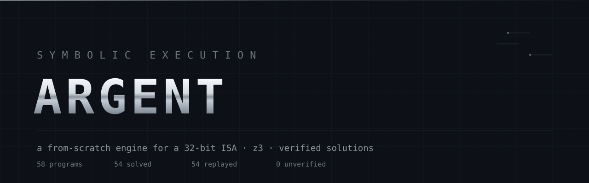
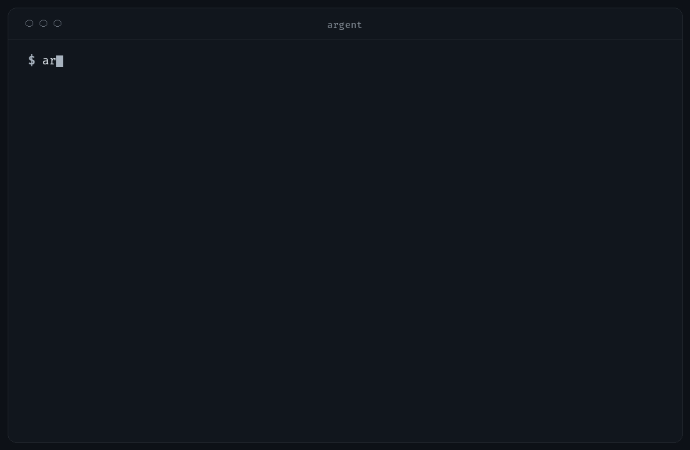

<div align="center">
  
</div>

<div align="center">

**English** &nbsp;·&nbsp; [Türkçe](README.tr.md) &nbsp;·&nbsp; [Русский](README.ru.md)

[](https://github.com/raxwqx/argent/actions/workflows/ci.yml)
[](LICENSE)

</div>

---

> A symbolic execution engine you can read in one afternoon.
>
> ◆ &nbsp;No SMT wrapper around a wrapper. `z3` is called directly.
> ◆ &nbsp;No unverified answers. Every input is replayed before it is reported.
> ◆ &nbsp;No magic. Every limit is written down.

<div align="center">
  
</div>

<div align="center"><sub>The GIF is not a mock-up. It is rendered from the CLI's own output by <code>tools/make_assets.py</code>.</sub></div>

---

## What it is

Argent is a from-scratch symbolic executor for a small 32-bit instruction set.
It assembles a text program, walks it symbolically, forks at data-dependent
branches, prunes infeasible paths with z3, extracts a model, and then proves the
model by running the program concretely.

The point is not to compete with angr. The point is that the entire analysis
pipeline — encoder, interpreter, explorer, solver bridge, replay — fits in about
1,600 lines, and you can audit all of it.

```
  .sasm source
      │
      ▼
  ┌───────────┐    8-byte instructions     ┌──────────────┐
  │ assembler │ ─────────────────────────▶ │  interpreter │
  └───────────┘                            └──────┬───────┘
                                                  │ symbolic state
                                                  ▼
                                          ┌──────────────┐
                                          │   explorer   │
                                          │  fork/prune  │
                                          └──────┬───────┘
                                                 │ path constraints
                                                 ▼
                                          ┌──────────────┐
                                          │     z3       │
                                          └──────┬───────┘
                                                 │ candidate input
                                                 ▼
                                          ┌──────────────┐
                                          │   replay     │  ← the part that
                                          │  (concrete)  │    makes it honest
                                          └──────────────┘
```

---

## Quickstart

```console
$ python -m venv .venv && . .venv/bin/activate
$ pip install -e ".[dev]"

$ python -m argent corpus -o corpus -p 1
wrote 8 program(s) to corpus

$ python -m argent solve corpus/hash-00.sasm -n 6
argent 0.1.0

  program    corpus/hash-00.sasm
  goal       @20 (win)
  input size 6 byte(s)

  status     sat
  input      50 b7 c0 34 0a 6f
  ascii      P..4.o
  verified   yes, concrete replay reached the goal

  paths      9
  forks      1
  pruned     0
  steps      367
  solver     3 call(s)
  time       0.291 s
```

Try the same input by hand:

```console
$ python -m argent run corpus/hash-00.sasm --hex 50b7c0340a6f
halted     yes
exit code  1
steps      67
trace      0 -> 1 -> 2 -> 3 -> 4 -> 5 -> 6 -> 7 -> 8 -> 9 -> 10 -> 11 -> 12 -> 13 -> 5 ...
```

A wrong input takes the other side of the branch and exits with 0:

```console
$ python -m argent run corpus/hash-00.sasm --hex 000000000000
exit code  0
```

---

## Write a challenge

```asm
# Accept a single byte equal to 0x41.
start:
    movi  r1, 0x1000
    loadb r2, r1, 0
    movi  r3, 0x41
    cmp   r2, r3
    jne   fail
    jmp   win
fail:
    movi  r0, 0
    syscall 1
win:
    movi  r0, 1
    syscall 1
```

```console
$ python -m argent solve examples/eq.sasm -n 1
  status     sat
  input      41
  ascii      A
  verified   yes, concrete replay reached the goal
```

`loadb` is the one primitive that reads a symbolic byte; `load` reads a full
word and `store` writes one, both requiring concrete addresses. That rule keeps
the memory model small and the results sound.

---

## The ISA

Sixteen registers, 32-bit words, 8-byte fixed instructions
(`<opcode:8, a:8, b:8, c:8, imm:32>`), `pc` measured in instruction indices.

| group | instructions |
|---|---|
| data movement | `movi` `mov` `load` `loadb` `store` |
| arithmetic | `add` `sub` `mul` |
| bitwise | `xor` `and` `or` `shl` `shr` |
| control | `cmp` `je` `jne` `jl` `jmp` |
| system | `nop` `halt` `syscall` |

Flags are `zf` (`a == b`) and `sf` (unsigned `a < b`). `syscall 1` halts with
the value of `r0`; any other syscall is a no-op. There are no real syscalls, no
I/O, and no interrupts.

The full encoding, semantics and design rationale live in
[docs/DESIGN.md](docs/DESIGN.md).

---

## Benchmarks

The corpus is generated from seed `1337`, so these numbers are reproducible:

```console
$ python bench/run.py
```

| family | n | solved | verified | mean ms | max ms | paths | forks |
|---|---:|---:|---:|---:|---:|---:|---:|
| `eq` | 8 | 8 | 8 | 4.9 | 9.9 | 2.0 | 1.0 |
| `xor` | 8 | 8 | 8 | 8.0 | 8.4 | 2.0 | 1.0 |
| `arith` | 8 | 8 | 8 | 4.3 | 8.3 | 2.0 | 1.0 |
| `chain` | 8 | 8 | 8 | 41.2 | 61.8 | 5.0 | 4.0 |
| `sum` | 8 | 8 | 8 | 35.4 | 67.9 | 9.0 | 1.0 |
| `hash` | 6 | 6 | 6 | 272.8 | 620.0 | 9.0 | 1.0 |
| `maze` | 8 | 8 | 8 | 14.2 | 21.0 | 9.0 | 5.0 |
| `impossible` | 4 | 0 | 0 | 4.1 | 5.5 | 4.0 | 2.0 |
| **total** | **58** | **54** | **54** | **44.0** | **620.0** | **5.2** | **2.0** |

Measured with CPython 3.14 on an eight-core i5-11320H, single process, no
warm-up. Run `bench/run.py --json bench/results.json` to regenerate every row.

Two things worth noticing:

- **`verified` equals `solved`.** A solution that fails concrete replay is
  counted separately; there are none.
- **`impossible` is 0/4 on purpose.** Its two guards cannot both hold, so the
  explorer must prune every path. A future regression that "solves" it would
  show up in this table.

---

## The honesty section

Symbolic execution attracts impressive-sounding claims. Here is the complete
list of what this engine does not do:

- **No symbolic memory addresses.** `load`/`loadb`/`store` through a computed
  address raise `Unsupported`, and the path is dropped.
- **No symbolic stores.** Writing a bit-vector to memory is unsupported.
- **No path merging or caching.** A loop unrolled `n` times is executed `n`
  times; there is no summarisation.
- **No unsat core, no optimisation passes, no taint.** Expressions go to z3
  roughly as the interpreter built them, with light `simplify` calls.
- **No binary loader.** Programs come from `.sasm` text or 8-byte-aligned
  buffers.
- **No concurrency, no incremental solver.** Each check builds a fresh
  `z3.Solver`.
- **The corpus is generated, not scraped.** It is a synthetic benchmark, not a
  collection of real-world crackmes.

If a claim is not in this README or in `docs/DESIGN.md`, the engine does not
make it.

---

## Layout

```
argent/
  isa.py        encoding, operand table, formatting
  asm.py        two-pass-free label resolution, Program
  machine.py    State, byte/word semantics, execute_step
  solver.py     z3 check + model extraction
  engine.py     Explorer, Result, run_concrete, verify
  corpus.py     deterministic crackme families
  bench.py      per-case timing, aggregation, table
  cli.py        solve / run / disasm / corpus / bench
examples/       two hand-written programs
tests/          84 tests: encoding, assembler, machine, engine, CLI, corpus
tools/          asset generator (GIF, MP4, SVG) driven by real CLI output
docs/           design notes
bench/run.py    benchmark entry point
```

---

## Development

```console
$ pytest -q            # 84 tests, about 5 seconds
$ ruff check .         # no warnings
$ python bench/run.py  # full corpus
$ python tools/make_assets.py   # regenerate hero and demo (needs pillow + ffmpeg)
```

Every result in this repository was produced by the code in this repository.
There are no placeholder screenshots and no fabricated timings.

---

## License

MIT. See [LICENSE](LICENSE).
