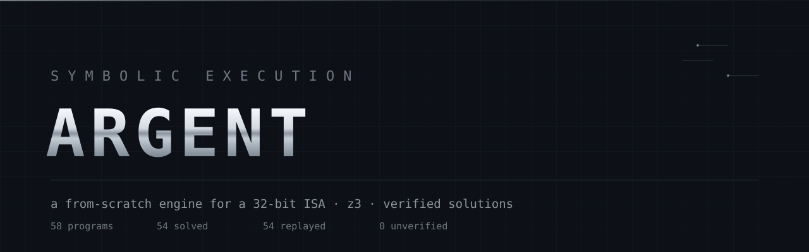
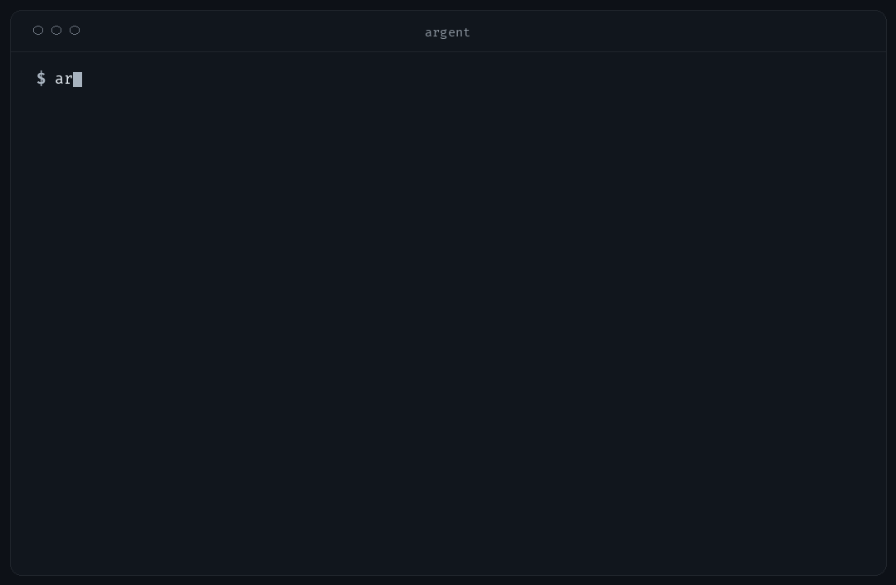

<div align="center">
  
</div>

<div align="center">

[English](README.md) &nbsp;·&nbsp; [Türkçe](README.tr.md) &nbsp;·&nbsp; **Русский**

[](https://github.com/raxwqx/argent/actions/workflows/ci.yml)
[](https://github.com/raxwqx/argent/releases)
[](LICENSE)
[](https://github.com/raxwqx/argent/discussions)

</div>

---

> Движок символьного исполнения, который можно прочитать за один вечер.
>
> ◆ &nbsp;Никаких обёрток над обёртками. `z3` вызывается напрямую.
> ◆ &nbsp;Никаких непроверенных ответов. Каждый вход переигрывается перед отчётом.
> ◆ &nbsp;Никакой магии. Каждое ограничение записано.

<div align="center">
  
</div>

<div align="center"><sub>GIF — не макет. Он собран из вывода самого CLI скриптом <code>tools/make_assets.py</code>.</sub></div>

---

## Что это

Argent — символьный исполнитель, написанный с нуля для небольшого 32-битного
набора инструкций. Он собирает текстовую программу, проходит её символьно,
ветвится на зависящих от данных переходах, отсекает невыполнимые пути через z3,
извлекает модель и затем доказывает её, запуская программу конкретно.

Цель не в том, чтобы тягаться с angr. Цель в том, чтобы весь конвейер анализа —
кодировщик, интерпретатор, исследователь, мост к решателю, переигровка —
умещался примерно в 1 600 строк и поддавался аудиту целиком.

<div align="center">
  
</div>

<div align="center"><sub>Этапы подсвечиваются в порядке исполнения. Правило внизу — то, что делает результат достоверным.</sub></div>

<div align="center"><sub><a href="https://raxwqx.github.io/argent/">открыть интерактивную версию</a> &#183; нажми на этап, чтобы увидеть модуль</sub></div>

---

## Установка

Argent — чистый Python-пакет: компилировать нечего, бинарников для скачивания
нет. Достаточно Python 3.9 или новее, `z3-solver` подтянется сам. Работает на
Linux, macOS и Windows.

**Из колеса релиза** (фиксированная версия, клонирование не нужно):

```console
$ pip install https://github.com/raxwqx/argent/releases/download/v0.1.0/argent_symex-0.1.0-py3-none-any.whl
$ argent --version
argent 0.1.0
```

**Из исходников** (editable-установка, вместе с тестами):

```console
$ git clone https://github.com/raxwqx/argent
$ cd argent
$ python -m venv .venv && . .venv/bin/activate
$ pip install -e ".[dev]"
```

**Изолированный CLI** через pipx:

```console
$ pipx install git+https://github.com/raxwqx/argent.git
```

Если нужен архив: `pip install <путь>/argent_symex-0.1.0.tar.gz` либо
`Code -> Download ZIP` на странице репозитория и
`pip install ./argent-master.zip`.

Дальше предполагается, что команда `argent` есть в `PATH`. Внутри репозитория
без установки то же самое делает `python -m argent ...`.

---

## Быстрый старт

```console
$ argent corpus -o corpus -p 1
wrote 8 program(s) to corpus

$ argent solve corpus/hash-00.sasm -n 6
argent 0.1.0

  program    corpus/hash-00.sasm
  goal       @20 (win)
  input size 6 byte(s)

  status     sat
  input      50 b7 c0 34 0a 6f
  ascii      P..4.o
  verified   yes, concrete replay reached the goal

  paths      9
  forks      1
  pruned     0
  steps      367
  solver     3 call(s)
  time       0.291 s
```

Проверьте тот же вход вручную:

```console
$ argent run corpus/hash-00.sasm --hex 50b7c0340a6f
halted     yes
exit code  1
steps      67
trace      0 -> 1 -> 2 -> 3 -> 4 -> 5 -> 6 -> 7 -> 8 -> 9 -> 10 -> 11 -> 12 -> 13 -> 5 ...
```

Неверный вход уходит в другую ветвь и завершается с кодом 0:

```console
$ argent run corpus/hash-00.sasm --hex 000000000000
halted     yes
exit code  0
steps      66
trace      0 -> 1 -> 2 -> 3 -> 4 -> 5 -> 6 -> 7 -> 8 -> 9 -> 10 -> 11 -> 12 -> 13 -> 5 ...
```

---

## Напишите проверку

```asm
# Принять один байт, равный 0x41.
start:
    movi  r1, 0x1000
    loadb r2, r1, 0
    movi  r3, 0x41
    cmp   r2, r3
    jne   fail
    jmp   win
fail:
    movi  r0, 0
    syscall 1
win:
    movi  r0, 1
    syscall 1
```

```console
$ argent solve examples/eq.sasm -n 1
  status     sat
  input      41
  ascii      A
  verified   yes, concrete replay reached the goal
```

`loadb` — единственный примитив, читающий символьный байт. `load` читает целое
слово, `store` пишет слово; обоим нужен конкретный адрес. Это правило держит
модель памяти маленькой, а результаты — корректными.

---

## Набор инструкций

Шестнадцать регистров, 32-битные слова, команды фиксированной длины 8 байт
(`<opcode:8, a:8, b:8, c:8, imm:32>`), `pc` измеряется в индексах инструкций.

| группа | инструкции |
|---|---|
| передача данных | `movi` `mov` `load` `loadb` `store` |
| арифметика | `add` `sub` `mul` |
| битовые операции | `xor` `and` `or` `shl` `shr` |
| управление | `cmp` `je` `jne` `jl` `jmp` |
| система | `nop` `halt` `syscall` |

Флаги: `zf` (`a == b`) и `sf` (беззнаковое `a < b`). `syscall 1` останавливает
программу со значением `r0`; любой другой номер syscall ничего не делает.
Настоящих системных вызовов, ввода-вывода и прерываний нет.

Полное кодирование, семантика и обоснование решений — в
[docs/DESIGN.md](docs/DESIGN.md).

---

## Замеры

Корпус генерируется из зерна `1337`, поэтому числа воспроизводимы:

```console
$ python bench/run.py
```

| семейство | n | решено | проверено | сред. мс | макс. мс | путей | ветвлений |
|---|---:|---:|---:|---:|---:|---:|---:|
| `eq` | 8 | 8 | 8 | 4.9 | 9.9 | 2.0 | 1.0 |
| `xor` | 8 | 8 | 8 | 8.0 | 8.4 | 2.0 | 1.0 |
| `arith` | 8 | 8 | 8 | 4.3 | 8.3 | 2.0 | 1.0 |
| `chain` | 8 | 8 | 8 | 41.2 | 61.8 | 5.0 | 4.0 |
| `sum` | 8 | 8 | 8 | 35.4 | 67.9 | 9.0 | 1.0 |
| `hash` | 6 | 6 | 6 | 272.8 | 620.0 | 9.0 | 1.0 |
| `maze` | 8 | 8 | 8 | 14.2 | 21.0 | 9.0 | 5.0 |
| `impossible` | 4 | 0 | 0 | 4.1 | 5.5 | 4.0 | 2.0 |
| **итого** | **58** | **54** | **54** | **44.0** | **620.0** | **5.2** | **2.0** |

Измерено на CPython 3.14, восьмиядерный i5-11320H, один процесс, без
прогрева. Все строки пересобираются командой
`bench/run.py --json bench/results.json`.

Две вещи, на которые стоит смотреть:

- **`проверено` равно `решено`.** Решение, не прошедшее конкретную
  переигровку, считается отдельно; таких нет.
- **`impossible` намеренно 0/4.** Два условия не могут выполняться
  одновременно, поэтому исследователь обязан отсечь все пути. Будущая
  регрессия, которая «решит» это семейство, сразу будет видна в таблице.

---

## Раздел честности

Символьное исполнение притягивает громкие заявления. Вот полный список того,
чего этот движок не делает:

- **Нет символьных адресов памяти.** `load`/`loadb`/`store` по вычисленному
  адресу вызывают `Unsupported`, путь отбрасывается.
- **Нет символьных записей.** Запись бит-вектора в память не поддерживается.
- **Нет слияния путей и кеша.** Цикл, раскрученный `n` раз, исполняется `n`
  раз; суммирования нет.
- **Нет unsat-core, оптимизационных проходов и taint.** Выражения уходят в z3
  примерно такими, какими их построил интерпретатор, с лёгкими `simplify`.
- **Нет загрузчика бинарников.** Программы приходят из текста `.sasm` или из
  буферов, выровненных по 8 байт.
- **Нет параллельности и инкрементального решателя.** Каждая проверка строит
  новый `z3.Solver`.
- **Корпус генерируется, а не собирается.** Это синтетический бенчмарк, а не
  коллекция реальных crackme.

Если утверждения нет в этом README или в `docs/DESIGN.md`, движок его не
делает.

---

## Структура

```
argent/
  isa.py        кодирование, таблица операндов, форматирование
  asm.py        разрешение меток, Program
  machine.py    State, семантика байт/слово, execute_step
  solver.py     z3 check + извлечение модели
  engine.py     Explorer, Result, run_concrete, verify
  corpus.py     детерминированные семейства crackme
  bench.py      замеры по кейсам, агрегация, таблица
  cli.py        solve / run / disasm / corpus / bench
examples/       две программы, написанные вручную
tests/          84 теста: кодирование, ассемблер, машина, движок, CLI, корпус
tools/          генератор ассетов (GIF, MP4, анимированный SVG) из реального вывода CLI
assets/         баннер, анимированный конвейер, запись терминала
docs/           заметки о дизайне
bench/run.py    точка входа бенчмарка
```

---

## Вопросы

Спрашивайте о движке, странном поведении программы или идее для ISA в
[Discussions](https://github.com/raxwqx/argent/discussions). Используйте
категорию **Q&A**, чтобы ответ можно было отметить и найти позже.

---

## Разработка

```console
$ pytest -q            # 84 теста, около 5 секунд
$ ruff check .         # без предупреждений
$ python bench/run.py  # полный корпус
$ python tools/make_assets.py   # пересобрать hero и демо (pillow + ffmpeg)
```

Каждый результат в этом репозитории получен кодом из этого репозитория.
Заглушек-скриншотов и выдуманных таймингов нет.

---

## Лицензия

MIT. См. [LICENSE](LICENSE).
