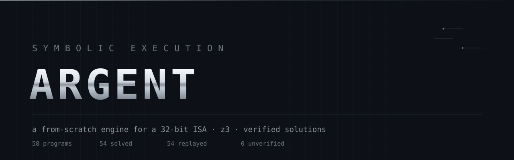
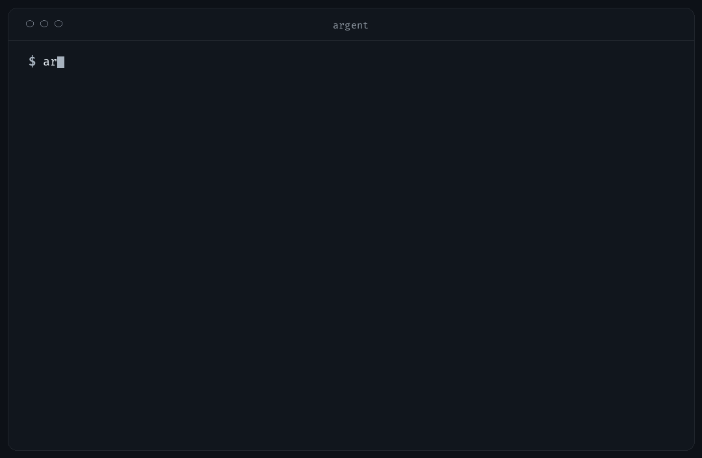

<div align="center">
  
</div>

<div align="center">

[English](README.md) &nbsp;·&nbsp; **Türkçe** &nbsp;·&nbsp; [Русский](README.ru.md)

[](https://github.com/raxwqx/argent/actions/workflows/ci.yml)
[](https://github.com/raxwqx/argent/releases)
[](LICENSE)

</div>

---

> Bir öğleden sonrada okunup bitirilebilecek bir sembolik yürütme motoru.
>
> ◆ &nbsp;Sarmalayıcının sarmalayıcısı yok. `z3` doğrudan çağrılıyor.
> ◆ &nbsp;Doğrulanmamış cevap yok. Her girdi, rapor edilmeden önce yeniden çalıştırılıyor.
> ◆ &nbsp;Sihir yok. Her sınır yazılı.

<div align="center">
  
</div>

<div align="center"><sub>GIF bir mock-up değil. <code>tools/make_assets.py</code> tarafından CLI'nin kendi çıktısından üretiliyor.</sub></div>

---

## Nedir

Argent, küçük bir 32 bit komut seti için sıfırdan yazılmış bir sembolik
yürütücüdür. Metin programını derler, sembolik olarak yürütür, veriye bağlı
dallarda çatal açar, imkânsız yolları z3 ile budar, bir model çıkarır ve sonra
bu modeli programı somut olarak çalıştırarak kanıtlar.

Amaç angr ile yarışmak değil. Amaç, kodlama, yorumlayıcı, keşif, çözücü köprüsü
ve tekrar oynatma dahil tüm hattın yaklaşık 1.600 satırda kalması ve tamamının
denetlenebilmesi.

<div align="center">
  
</div>

<div align="center"><sub>Aşamalar yürütme sırasına göre yanar. Alttaki kural, sonucu güvenilir yapan kısımdır.</sub></div>

---

## Kurulum

Argent saf Python paketi; derlenecek bir şey yok, indirilecek ikili dosya da
yok. Python 3.9 veya üstü yeterli, `z3-solver` kendiliğinden gelir. Linux,
macOS ve Windows üzerinde çalışır.

**Sürüm tekerleğinden** (sürümü sabitler, klon gerekmez):

```console
$ pip install https://github.com/raxwqx/argent/releases/download/v0.1.0/argent_symex-0.1.0-py3-none-any.whl
$ argent --version
argent 0.1.0
```

**Kaynaktan** (düzenlenebilir kurulum, testler dahil):

```console
$ git clone https://github.com/raxwqx/argent
$ cd argent
$ python -m venv .venv && . .venv/bin/activate
$ pip install -e ".[dev]"
```

**İzole CLI** istiyorsanız pipx ile:

```console
$ pipx install git+https://github.com/raxwqx/argent.git
```

Arşiv tercih ederseniz `pip install <yol>/argent_symex-0.1.0.tar.gz`, ya da
depo sayfasından `Code -> Download ZIP` alıp `pip install ./argent-master.zip`.

Aşağıdaki komutlar `argent` giriş noktasının `PATH` üzerinde olduğunu varsayar.
Kurulum yapmadan depo içinde `python -m argent ...` aynı işi görür.

---

## Hızlı başlangıç

```console
$ argent corpus -o corpus -p 1
wrote 8 program(s) to corpus

$ argent solve corpus/hash-00.sasm -n 6
argent 0.1.0

  program    corpus/hash-00.sasm
  goal       @20 (win)
  input size 6 byte(s)

  status     sat
  input      50 b7 c0 34 0a 6f
  ascii      P..4.o
  verified   yes, concrete replay reached the goal

  paths      9
  forks      1
  pruned     0
  steps      367
  solver     3 call(s)
  time       0.291 s
```

Aynı girdiyle elle deneyin:

```console
$ argent run corpus/hash-00.sasm --hex 50b7c0340a6f
halted     yes
exit code  1
steps      67
trace      0 -> 1 -> 2 -> 3 -> 4 -> 5 -> 6 -> 7 -> 8 -> 9 -> 10 -> 11 -> 12 -> 13 -> 5 ...
```

Yanlış bir girdi dalın diğer tarafına gider ve 0 ile çıkar:

```console
$ argent run corpus/hash-00.sasm --hex 000000000000
halted     yes
exit code  0
steps      66
trace      0 -> 1 -> 2 -> 3 -> 4 -> 5 -> 6 -> 7 -> 8 -> 9 -> 10 -> 11 -> 12 -> 13 -> 5 ...
```

---

## Bir kapı yazın

```asm
# 0x41 değerine eşit tek bir bayt kabul et.
start:
    movi  r1, 0x1000
    loadb r2, r1, 0
    movi  r3, 0x41
    cmp   r2, r3
    jne   fail
    jmp   win
fail:
    movi  r0, 0
    syscall 1
win:
    movi  r0, 1
    syscall 1
```

```console
$ argent solve examples/eq.sasm -n 1
  status     sat
  input      41
  ascii      A
  verified   yes, concrete replay reached the goal
```

Sembolik baytı okuyan tek ilkel `loadb`. `load` tam bir kelime okur, `store`
kelime yazar; ikisi de somut adres ister. Bu kural bellek modelini küçük,
sonuçları sağlam tutar.

---

## Komut seti

On altı yazmaç, 32 bit kelime, 8 baytlık sabit komutlar
(`<opcode:8, a:8, b:8, c:8, imm:32>`), `pc` komut indeksi olarak ölçülür.

| grup | komutlar |
|---|---|
| veri taşıma | `movi` `mov` `load` `loadb` `store` |
| aritmetik | `add` `sub` `mul` |
| bit işlemleri | `xor` `and` `or` `shl` `shr` |
| kontrol | `cmp` `je` `jne` `jl` `jmp` |
| sistem | `nop` `halt` `syscall` |

Bayraklar `zf` (`a == b`) ve `sf` (işaretsiz `a < b`). `syscall 1`, `r0`
değeriyle durur; diğer syscall numaraları hiçbir şey yapmaz. Gerçek syscall,
G/Ç veya kesme yoktur.

Kodlamanın, anlambilimin ve tasarım gerekçelerinin tamamı
[docs/DESIGN.md](docs/DESIGN.md) içinde.

---

## Ölçümler

Korpus `1337` tohumundan üretilir, yani sayılar tekrar üretilebilir:

```console
$ python bench/run.py
```

| aile | n | çözülen | doğrulanan | ort. ms | azami ms | yol | çatal |
|---|---:|---:|---:|---:|---:|---:|---:|
| `eq` | 8 | 8 | 8 | 4.9 | 9.9 | 2.0 | 1.0 |
| `xor` | 8 | 8 | 8 | 8.0 | 8.4 | 2.0 | 1.0 |
| `arith` | 8 | 8 | 8 | 4.3 | 8.3 | 2.0 | 1.0 |
| `chain` | 8 | 8 | 8 | 41.2 | 61.8 | 5.0 | 4.0 |
| `sum` | 8 | 8 | 8 | 35.4 | 67.9 | 9.0 | 1.0 |
| `hash` | 6 | 6 | 6 | 272.8 | 620.0 | 9.0 | 1.0 |
| `maze` | 8 | 8 | 8 | 14.2 | 21.0 | 9.0 | 5.0 |
| `impossible` | 4 | 0 | 0 | 4.1 | 5.5 | 4.0 | 2.0 |
| **toplam** | **58** | **54** | **54** | **44.0** | **620.0** | **5.2** | **2.0** |

Sekiz çekirdekli i5-11320H üzerinde CPython 3.14, tek süreç, ısınma yok.
Her satırı yeniden üretmek için `bench/run.py --json bench/results.json`.

İki nokta dikkat çekiyor:

- **`doğrulanan` = `çözülen`.** Somut tekrar oynatmada başarısız olan çözüm ayrı
  sayılır; hiç yok.
- **`impossible` bilerek 0/4.** İki koruma aynı anda doğru olamaz, bu yüzden
  keşfedici tüm yolları budamak zorunda. İleride bu aileyi "çözen" bir hata
  tabloda hemen görünür.

---

## Dürüstlük bölümü

Sembolik yürütme, etkileyici görünen iddiaları kendine çeker. Bu motorun
yapmadıklarının tam listesi:

- **Sembolik bellek adresi yok.** Hesaplanmış adresle `load`/`loadb`/`store`
  `Unsupported` fırlatır ve yol düşürülür.
- **Sembolik store yok.** Belleğe bit-vektörü yazmak desteklenmez.
- **Yol birleştirme veya önbellek yok.** `n` kez açılan bir döngü `n` kez
  yürütülür; özetleme yoktur.
- **Unsat çekirdek, optimizasyon geçişi, taint yok.** İfadeler z3'e kabaca
  yorumlayıcının kurduğu hâlde gider; yalnızca hafif `simplify` çağrıları var.
- **İkili dosya yükleyici yok.** Programlar `.sasm` metninden veya 8 bayta
  hizalı tamponlardan gelir.
- **Eşzamanlılık ve artımlı çözücü yok.** Her kontrol yeni bir `z3.Solver`
  kurar.
- **Korpus üretilir, kazınmaz.** Bu sentetik bir kıyaslama kümesi, gerçek
  dünya crackme arşivi değil.

Bir iddia bu README'de veya `docs/DESIGN.md` içinde yoksa, motor o iddiayı
yapmıyor.

---

## Dizinler

```
argent/
  isa.py        kodlama, operand tablosu, biçimlendirme
  asm.py        etiket çözümü, Program
  machine.py    State, bayt/kelime anlambilimi, execute_step
  solver.py     z3 check + model çıkarımı
  engine.py     Explorer, Result, run_concrete, verify
  corpus.py     deterministik crackme aileleri
  bench.py      vaka süreleri, toplama, tablo
  cli.py        solve / run / disasm / corpus / bench
examples/       elle yazılmış iki program
tests/          84 test: kodlama, derleyici, makine, motor, CLI, korpus
tools/          varlık üreteci (GIF, MP4, hareketli SVG), gerçek CLI çıktısından
assets/         banner, hareketli hat, terminal kaydı
docs/           tasarım notları
bench/run.py    kıyaslama giriş noktası
```

---

## Geliştirme

```console
$ pytest -q            # 84 test, yaklaşık 5 saniye
$ ruff check .         # uyarı yok
$ python bench/run.py  # tam korpus
$ python tools/make_assets.py   # hero ve demoyu yeniden üret (pillow + ffmpeg)
```

Bu depodaki her sonuç, bu depodaki kod tarafından üretildi. Yer tutucu ekran
görüntüsü ve uydurma süre yok.

---

## Lisans

MIT. Bkz. [LICENSE](LICENSE).
